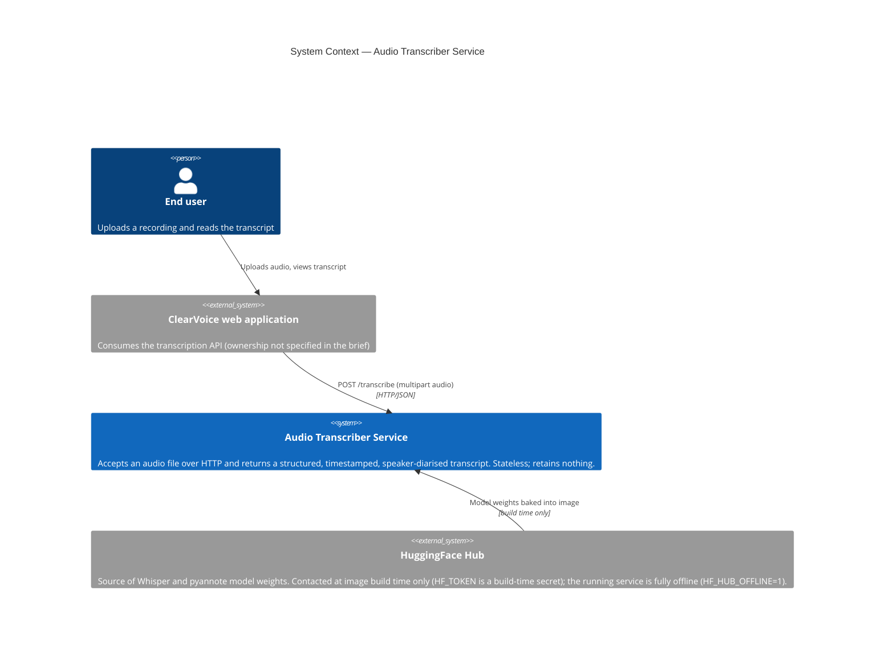
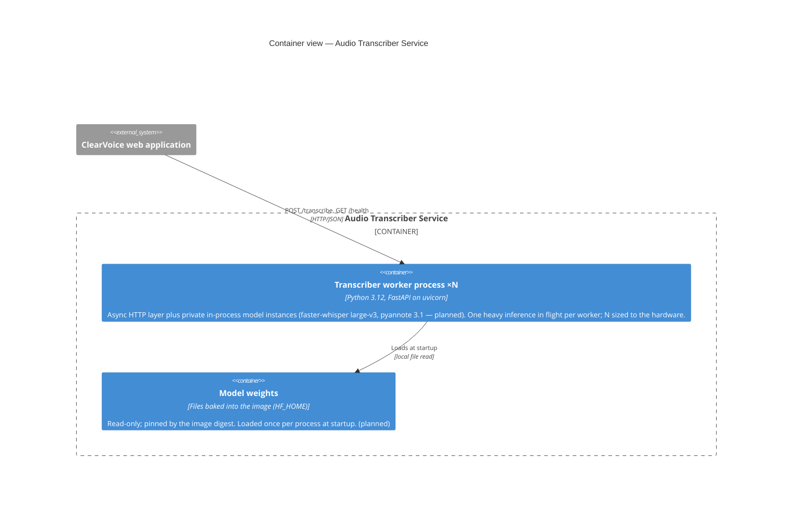
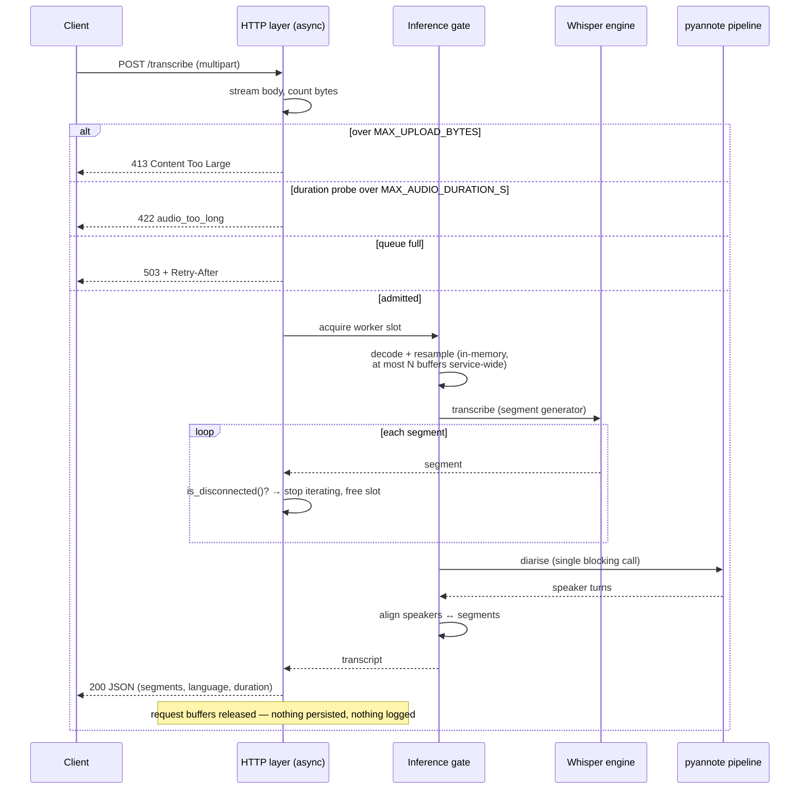
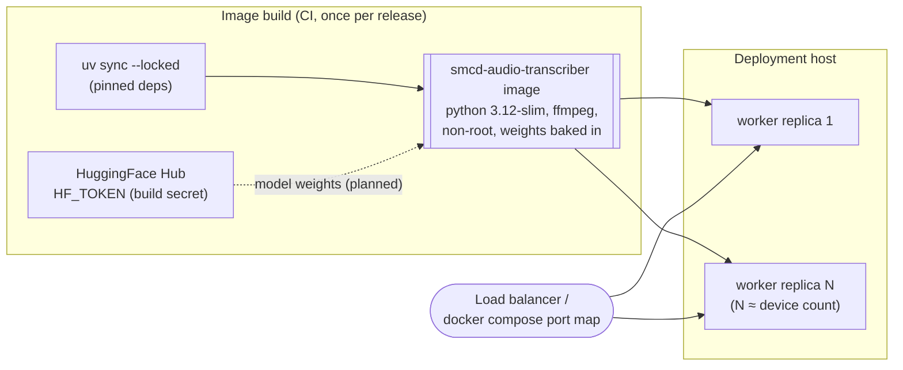

# Architecture Description — ClearVoice Audio Transcriber Service

**Date:** 2026-07-06
**Status:** Living document — reflects Increment 1 (project skeleton); the target
architecture is decided in [ADR-0001](adr/0001-transcription-backend.md) and
[ADR-0002](adr/0002-concurrency-and-resource-model.md) and shown here as *planned*.

---

## 1. Purpose and scope

This document describes the architecture of the Audio Transcriber Service: an
HTTP service that accepts an uploaded audio file and returns a structured,
timestamped, speaker-diarised transcript (see
[PROJECT_BRIEF.md](../PROJECT_BRIEF.md)).

It follows the [C4 model](https://c4model.com/) — System Context, Containers,
Components, and Code — plus a runtime view (request lifecycle) and a deployment
view. Elements that do not exist yet in the codebase are explicitly marked
**(planned)** with a reference to the roadmap story or ADR that defines them.

**Diagram notation:** [Mermaid](https://mermaid.js.org/). Rationale: it is
diagram-as-code (reviewable in pull requests, versioned alongside the ADRs it
illustrates) and renders natively on GitHub and in most editors, so the
diagrams need no external tooling or exported images. Context and container
diagrams use Mermaid's C4 syntax; component and runtime views use flowchart
and sequence diagrams, which render more reliably at that level of detail.

---

## 2. Architectural drivers

Five constraints shape every decision below — the first four from the brief,
the fifth from ADR-0001:

1. **Privacy by design.** Uploaded audio and transcript content must never be
   written to disk, logged, or retained after the response. This rules out any
   persistence tier and (per ADR-0001) motivated self-hosted models over cloud
   transcription APIs — no audio ever leaves the service boundary.
2. **Compute-bound inference in-process.** Transcription (faster-whisper) and
   diarisation (pyannote) are heavy model inference, not I/O. Concurrency is
   therefore achieved with **process workers**, each owning private model
   instances, never shared threads (ADR-0002 §1).
3. **Predictable behaviour under load.** Bounded queue with `503` backpressure,
   upload-size and duration ceilings, and a hard per-request timeout — shedding
   load is preferred to OOM (ADR-0002 §2–3).
4. **Reproducible, self-contained deployment.** Model weights are baked into
   the container image at build time; the running container needs no network
   access and no credentials (ADR-0001, model sourcing strategy).
5. **German-language accuracy.** ADR-0001 lists German support as a decision
   driver (motivating the `large-v3` model), and the test specification
   measures its quality thresholds (WER ≤ 15 %, DER ≤ 20 %) on German
   fixtures. *Traceability note:* this requirement appears in ADR-0001 and
   the test specification but not in the project brief; the gap was raised
   with the product owner in the 2026-07-06 QA review (F-03).

---

## 3. Level 1 — System Context

The service is a single backend component of the ClearVoice product. It has
**no runtime external dependencies** — that is a deliberate consequence of the
privacy constraint, not an omission. The only third-party system involved,
HuggingFace Hub, participates at **image build time only**.



| Element | Responsibility | Status |
|---|---|---|
| Audio Transcriber Service | Transcription + diarisation API; the system this document describes | Skeleton (liveness endpoint only) |
| ClearVoice web application | Consumes the API; out of scope here | External |
| HuggingFace Hub | One-time, build-time source of model weights | External, build-time only |

---

## 4. Level 2 — Containers

The system is deliberately minimal: **one container type, replicated N times,
and nothing else**. There is no database, cache, or message broker — statelessness
is the enforcement mechanism for the no-retention privacy requirement.



Key container-level decisions (from ADR-0002):

- **Scaling unit = process.** `uvicorn --workers N` or N replicas behind a load
  balancer. Each worker holds a full copy of model memory (~3 GB VRAM float16
  or ~1.5 GB RAM int8), so N is sized to device count / memory budget.
- **Why not threads:** pyannote's pipeline is not thread-safe when shared, and
  a single compute device serialises heavy inference anyway — threads would add
  risk without throughput.
- **Why no storage tier:** anything the service persisted would violate the
  privacy constraint. Audio lives only in request-scoped memory buffers.

---

## 5. Level 3 — Components (inside one worker process)

This is where as-built and as-designed diverge most. Today the worker contains
only the application factory and a liveness route; the diagram shows the target
component set with each component's origin story marked.

```mermaid
flowchart TB
    client([HTTP client])

    subgraph worker["Transcriber worker process (Python 3.12)"]
        direction TB
        entry["Entrypoint / config<br/><code>__init__.py:main</code><br/>env → uvicorn runner"]
        appf["App factory + routes<br/><code>main.py:create_app</code><br/>liveness /, lifespan logging"]

        subgraph planned["Planned components (roadmap increments 1–6)"]
            direction TB
            health["Health check<br/>GET /health — model readiness (US-02)"]
            limits["Upload guards<br/>streaming size limit → 413,<br/>duration probe → 422 (US-23)"]
            decode["Audio decode — inside worker slot<br/>WAV in-memory (US-03);<br/>ffmpeg multi-format from Increment 3 (US-08/09)"]
            gate["Inference gate<br/>bounded queue (depth 32) → 503,<br/>per-worker semaphore (ADR-0002)"]
            asr["Transcription engine<br/>faster-whisper large-v3,<br/>segment generator (US-03)"]
            dia["Diarisation pipeline<br/>pyannote 3.1, single blocking call<br/>(Increment 2)"]
            align["Speaker–segment alignment<br/>(Increment 2)"]
            resp["Response builder<br/>segments, language, duration,<br/>canonical error envelope"]
            stream["Streaming endpoint<br/>SSE/WebSocket (Increment 6, extra credit)"]
        end
    end

    client --> appf
    appf --> health
    appf --> limits
    limits --> gate
    gate --> decode
    decode --> asr
    decode --> dia
    asr --> align
    dia --> align
    align --> resp
    resp --> client
    entry -. "constructs" .-> appf

    style planned fill:none,stroke-dasharray:5 5
```



| Component | Responsibility | Status |
|---|---|---|
| Entrypoint / config | Reads `HOST`/`PORT`/`LOG_LEVEL`, runs uvicorn with graceful SIGTERM shutdown | **Built** ([`__init__.py`](../src/smcd_audio_transcriber/__init__.py)) |
| App factory + routes | Constructs isolated FastAPI instances (testability); liveness `/`; lifespan logging that never touches request content | **Built** ([`main.py`](../src/smcd_audio_transcriber/main.py)) |
| Health check | Readiness gated on model load | Planned — US-02 |
| Upload guards | `MAX_UPLOAD_BYTES` enforced while streaming (never buffer-then-measure); `MAX_AUDIO_DURATION_S` via metadata probe before decode | Planned — US-23, ADR-0002 §3 |
| Audio decode | Runs inside the acquired worker slot, so at most N decoded buffers are resident (ADR-0002 §3). WAV decoded in-memory (US-03); ffmpeg-based multi-format decode from Increment 3 (US-08/09) — ffmpeg is already installed in the runtime image | Planned — Increments 1/3 |
| Inference gate | Bounded admission queue (`503` + `Retry-After` when full); one in-flight inference per model instance | Planned — ADR-0002 §§1–2 |
| Transcription engine | faster-whisper `large-v3`; segment generator enables disconnect checks between segments | Planned — US-03, ADR-0001 |
| Diarisation + alignment | pyannote pipeline; manual speaker–segment alignment | Planned — Increment 2 |
| Streaming endpoint | Real-time segments over SSE/WebSocket | Planned — Increment 6 |

---

## 6. Runtime view — request lifecycle (target design)

The lifecycle below encodes ADR-0002's decisions on backpressure, cancellation,
and the privacy boundary. Cancellation granularity is one transcript segment;
an in-flight pyannote call runs to completion but its result is discarded and
the slot freed immediately (the one honest limitation of the design).
Rejection checks run cheapest-first — size while streaming, then metadata
duration probe, then queue admission — and full decode happens only after a
worker slot is acquired, which is what bounds resident PCM buffers to N
(ADR-0002 §§1, 3).



A hard per-request timeout (`REQUEST_TIMEOUT_S`) bounds worst-case slot
occupancy even when no disconnect occurs.

---

## 7. Deployment view

**As built:** a two-stage Dockerfile (uv builder → `python:3.12-slim` runtime,
non-root `appuser`, ffmpeg preinstalled) run via docker-compose with a 30 s
`stop_grace_period` so in-flight requests can finish on SIGTERM. Local runs use
`uv run smcd-audio-transcriber`.

**As designed (ADR-0001):** the image additionally bakes the Whisper and
pyannote weights (image grows to ~5–8 GB; `HF_TOKEN` needed at build only), and
production runs N replicas sized to the hardware.



### Configuration surface

All tunables are environment variables with safe defaults; the running
container needs no secrets.

| Variable | Default | Status |
|---|---|---|
| `HOST` / `PORT` / `LOG_LEVEL` | `0.0.0.0` / `8000` / `info` | Built |
| `MAX_UPLOAD_BYTES` | 100 MB | Planned (US-23) |
| `MAX_AUDIO_DURATION_S` | 7200 | Planned (US-23) |
| `QUEUE_DEPTH` | 32 | Planned (ADR-0002) |
| `REQUEST_TIMEOUT_S` | 1.5 × max duration at worst RTF | Planned (ADR-0002) |
| `WORKERS` | hardware-sized | Planned (ADR-0002) |

---

## 8. Level 4 — Code

The codebase is intentionally small at this stage:

```
src/smcd_audio_transcriber/
  __init__.py      console-script entrypoint: env config → uvicorn runner
  main.py          create_app() factory, lifespan hooks, liveness route
tests/
  generate_fixtures.py   synthetic audio fixture generator (test spec §2)
docs/
  adr/             ADR-0001 (backend), ADR-0002 (concurrency & resources)
  implementation-roadmap.md, test-specification.md, architecture.md (this file)
```

Conventions already in force: exact-pinned dependencies (`uv.lock`), ruff
lint/format, basedpyright in standard mode, app-factory pattern for test
isolation, and docstrings that cite the requirement they satisfy (e.g.
REQ-PRIV, US-01).

---

## 9. Cross-cutting concerns

- **Privacy** is enforced structurally, not procedurally: no storage tier
  exists, models run in-process, logs are content-free by rule, and any
  temporary decode artefacts must be gone before the response returns
  (ADR-0001 consequences). "In-memory" means *not persisted*, with memory
  bounded by bounding concurrency rather than by chunking (ADR-0002 §3).
- **Error contract:** every non-2xx response uses the canonical envelope
  `{"error": {"code": "...", "message": "..."}}`; a global exception handler
  overrides FastAPI's default `{"detail": ...}` body. The
  [test specification §3](test-specification.md#3-acceptance-thresholds) is
  the source of truth for this table:

  | Status | `code` | Condition |
  |---|---|---|
  | `400` | `missing_file` / `bad_request` | Missing or malformed file field |
  | `400` | `empty_file` | Zero-byte upload |
  | `413` | `file_too_large` | Upload exceeds `MAX_UPLOAD_BYTES` |
  | `415`/`422` | `unsupported_format` | Content is not decodable audio |
  | `422` | `audio_too_long` | Duration exceeds `MAX_AUDIO_DURATION_S` |
  | `503` | `overloaded` | Queue full; includes `Retry-After` |

  The robustness goal is *no 5xx on any input* other than deliberate `503`
  load shedding.
- **Observability:** process lifecycle logging exists today; anything richer
  must respect the content-free logging rule.

## 10. Document maintenance

Update this document when an increment lands (move components from *planned*
to *built*), when an ADR is added or superseded, or when the deployment
topology changes. Diagram source is inline Mermaid — edit in place.
